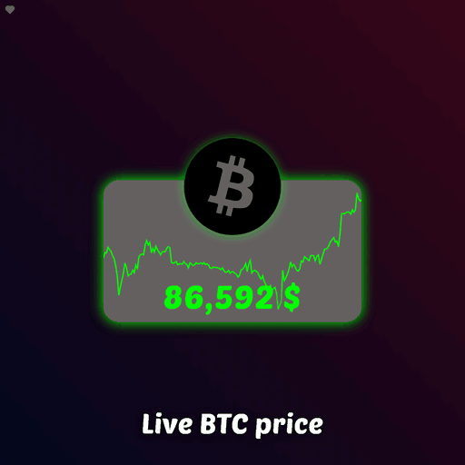
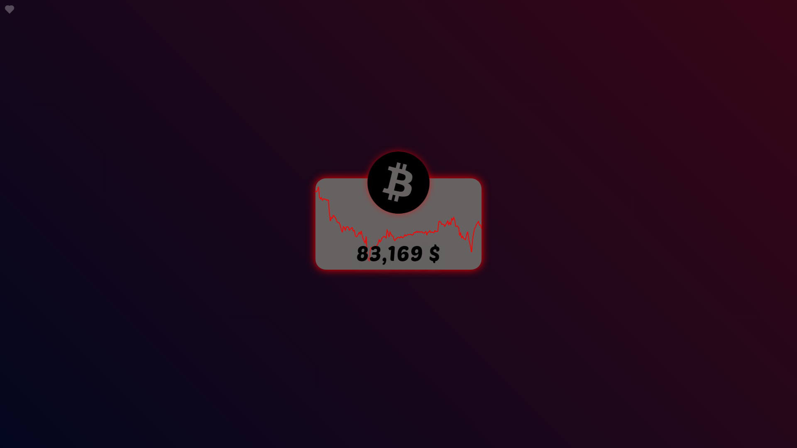
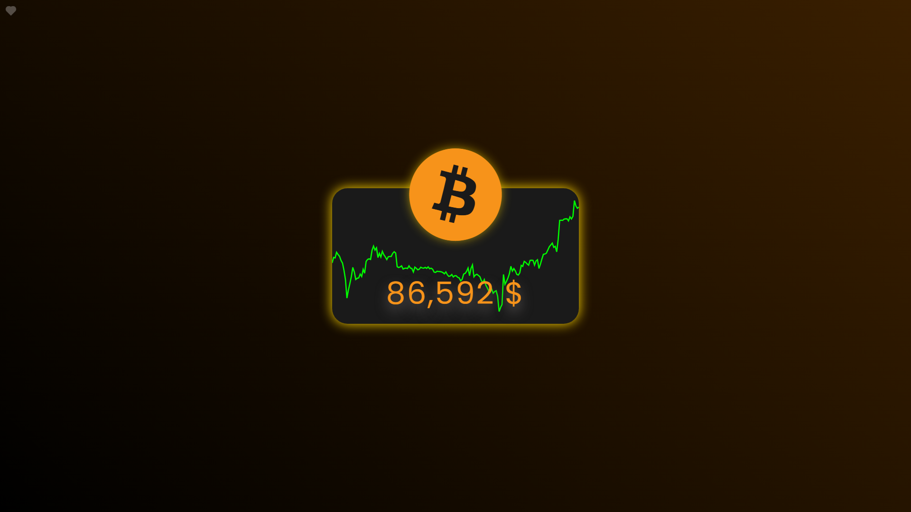
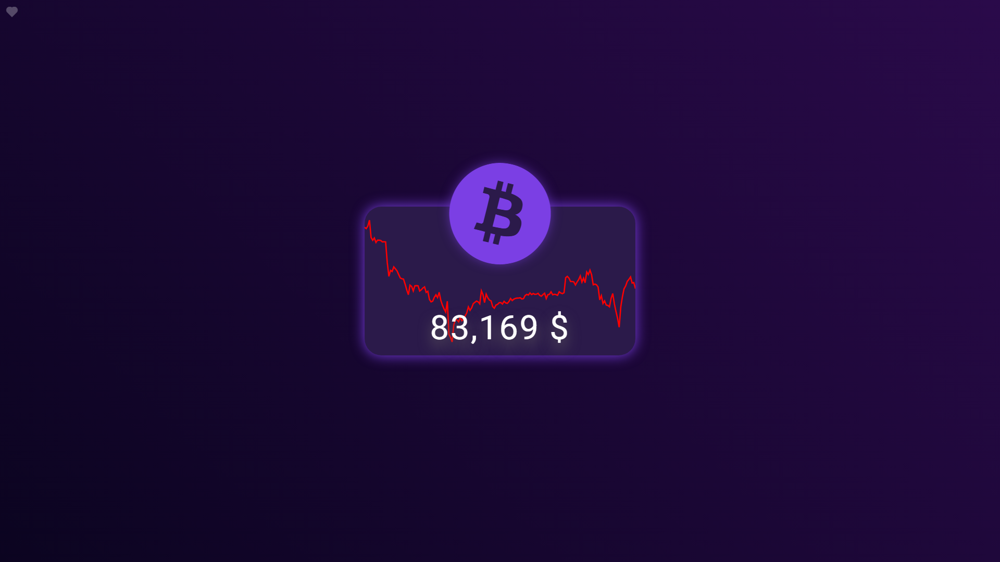
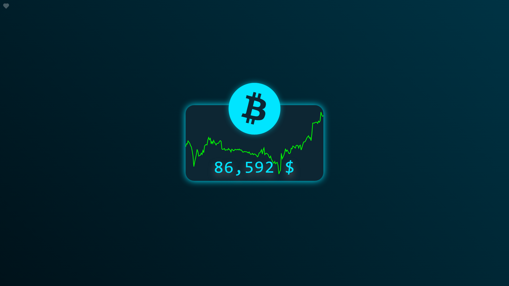
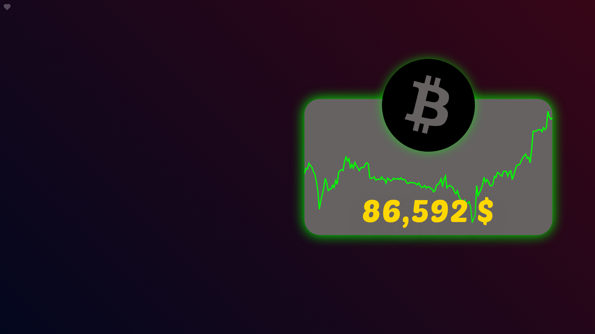
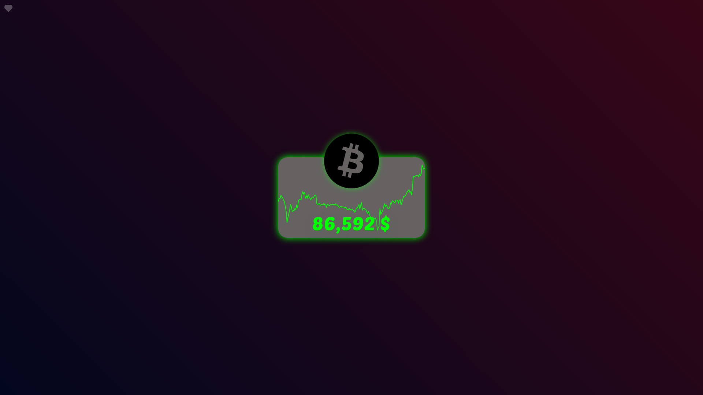
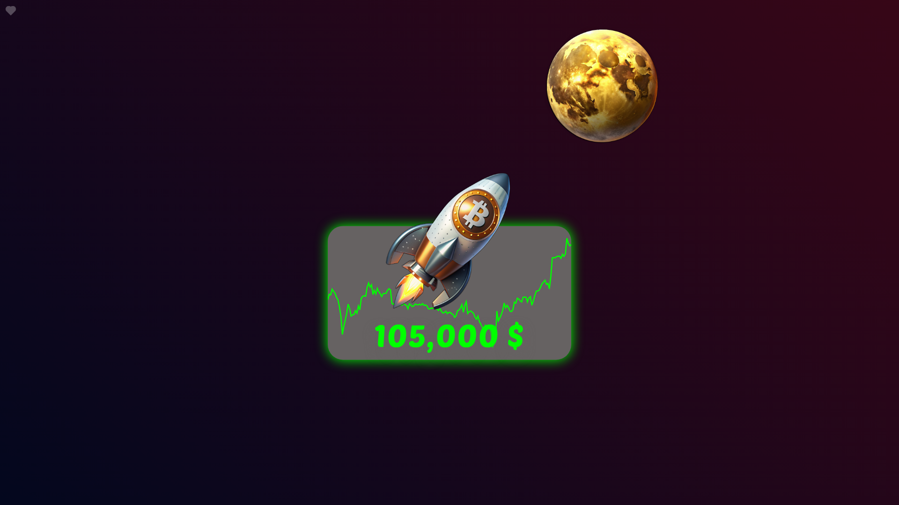
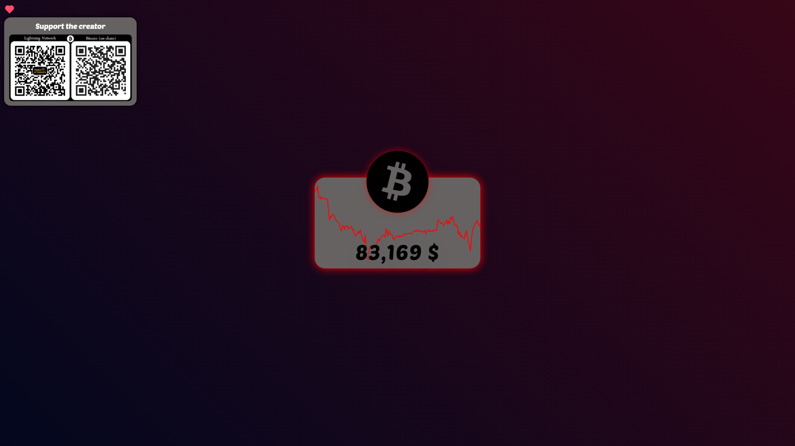

# Bitcoin Price Tracker for Wallpaper Engine
A dynamic wallpaper for Wallpaper Engine that displays the current price of Bitcoin (USD) and a 7-day price chart. The appearance can be customized directly in the Wallpaper Engine properties panel.
- [Project on Steam](https://steamcommunity.com/sharedfiles/filedetails/?id=2804470667)
- [Project example](https://cv0x.github.io/Bitcoin-Real-Time-Price-Tracker/)

  

## Description

This project creates a customizable wallpaper for the [Wallpaper Engine](https://store.steampowered.com/app/431960/Wallpaper_Engine/) program, displaying the real-time Bitcoin (BTC) price in USD and a 7-day price chart. Data is loaded from the [CoinGecko API](https://www.coingecko.com/en/api) every 60 seconds and the chart is drawn from its 7-day sparkline data.

## Usage

1. Log in to Steam in your browser.
2. Subscribe to this [BITCOIN WALLPAPER](https://steamcommunity.com/sharedfiles/filedetails/?id=2804470667).
3. Open Wallpaper Engine and select the wallpaper in the Installed tab.
4. Customize it in the properties panel on the right side of Wallpaper Engine (changes apply instantly).

## Customization Options

All options are defined in [project.json](project.json) as Wallpaper Engine user properties and are received in [app.js](app.js) via `window.wallpaperPropertyListener`.

| Property | Options | Default |
|---|---|---|
| Font | Poppins, Roboto, Playfair, Poetsen, Cursive, Sans-serif, Monospace | Poetsen |
| Price color | Custom color, Interactive (7d trend), Bitcoin color presets | Custom color (black) |
| Logo & card shadow | Off, Custom color, Interactive (7d trend), Bitcoin color presets | Interactive |
| Logo color | Any color | Black |
| Card color | Any color | Gray |
| Background | Two-color gradient presets or Custom colors | Classic Night |
| Background color 1 / 2 | Any color (shown with Custom colors) | Dark blue / dark red |
| Show 7-day chart | On / Off | On |
| Size | 50 – 250 % | 100 % |
| Horizontal / vertical position | -45 – 45 % of the screen | 0 (center) |

| Bitcoin Orange | Lightning Purple |
|---|---|
|  |  |
| **Diamond Hands** | **Size 200 % moved to the right** |
|  |  |

### Bitcoin color presets
Bitcoin Orange, Satoshi Gold, Golden Moon, Digital Silver, Lightning Purple, Laser Eyes Red, HODL Green, Blockchain Blue, Diamond Hands Cyan, Pizza Day Orange, Whitepaper White, Cold Wallet Black.

### Background presets
Classic Night, Bitcoin Ember, Satoshi Gold, Lightning Storm, Deep Ocean, HODL Forest, Laser Eyes, Moonlight, Sunset Pump, Cold Storage, Pure Black – or pick any two colors with Custom colors.

### Interactive color
Price color and shadow can follow the 7-day trend. They use the same color as the chart line: green when the price is higher than 7 days ago, red when it is lower.

| Downtrend | Uptrend |
|---|---|
|  |  |

## Easter Eggs
- **To the moon** – a rocket replaces the logo when the price is between 99,000 $ and 110,000 $, and the golden moon appears between 100,000 $ and 110,000 $.
- ...and maybe a few more hidden surprises. 🤫

Easter eggs are re-checked with every price update, so they switch on and off while the wallpaper keeps running.

## Support the creator
Hover over the small heart in the top left corner to show the Lightning and on-chain BTC QR codes.

## License

This project is open source and available under the MIT License. See the [LICENSE](LICENSE) file for details.
